# Playtest Feedback Hub — User Experience Design

Playtest Feedback Hub helps developers collect and review playtest feedback and helps testers submit feedback for a project. This document presents the team's existing Figma designs and their exported assets for Sprint 0.

## Mobile prototype

[Open the Figma mobile prototype](https://www.figma.com/proto/YAxqyt3IAmlQugrZ0yamge/Playtest-Feedback-Hub---Wireframes---Prototype?node-id=4-46&scaling=scale-down&content-scaling=fixed&page-id=0%3A1&starting-point-node-id=4%3A46).

The prototype opens at the Playtester Hub in an iPhone 17 presentation. The intended core walkthroughs are:

- Developer: hub → My Projects → Add Project or project feedback → filter/view feedback → mark resolved; display a project QR code for testers.
- Playtester: hub → scan project QR code → write feedback → submission confirmation → scan another project or return to the hub.
- Shared: account, feedback history, menu, sign out and mode switching.

These describe the intended flows shown by the design, not a claim that all prototype controls work. See the verification notes below before submission.

## Design sources and exports

- [Editable App Map in FigJam](https://www.figma.com/board/PyHDnniY1UbfuyAUbWh4X6/Playtest-Feedback-Hub---App-Map?node-id=0-1) · [local FigJam source](ux-design/app-map.jam)
- [Wireframes and prototype in Figma](https://www.figma.com/design/YAxqyt3IAmlQugrZ0yamge/Playtest-Feedback-Hub---Wireframes---Prototype?node-id=0-1) · [local Figma source](ux-design/prototype/playtest-feedback-hub.fig)
- [Individual PNG wireframes](ux-design/wireframes/) · [App Map PNG](ux-design/app-map.png)

Assets were exported from the team's existing files on October 19, 2026. The `.fig` source contains the wireframes and prototype connections together. PNGs are 1× exports of the original frames, with no browser chrome or canvas annotations. Only the empty outer white margin was trimmed from the App Map export. The original `wireframes.drawio` is retained; it contains the starter brochure-site example and is not the source of the Playtest Feedback Hub screens below.

## App Map

The App Map shows the parent/child structure for the developer and playtester areas. Developer branches cover project creation, feedback review/status management and QR display. The playtester branch covers scanning, feedback writing and category selection. Some nodes represent steps within one screen rather than separate phone screens.

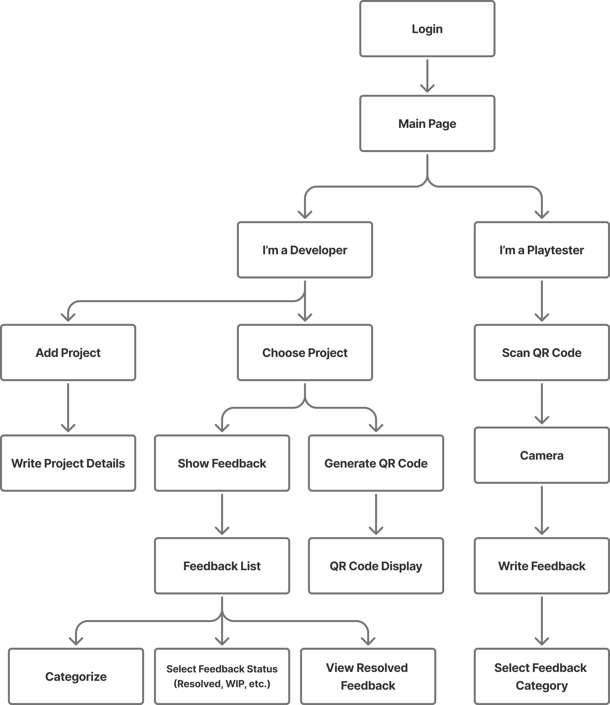

The map labels Login before Main Page; the wireframes instead show a welcome screen followed by sign-in/sign-up screens. Account, menu, history and confirmation are additional wireframe views. These differences are retained for team review rather than silently changing a teammate's design.

## Wireframes

Screens are presented in task order. Full phone frames are 402 × 874px; the menu panel is 286 × 874px. The following descriptions distinguish visible screen content from intended navigation that still needs verification.

### Entry and authentication

#### Welcome

Introduces Playtest Feedback Hub and offers Sign in and Sign Up. This is the wireframe named Main Page in Figma.

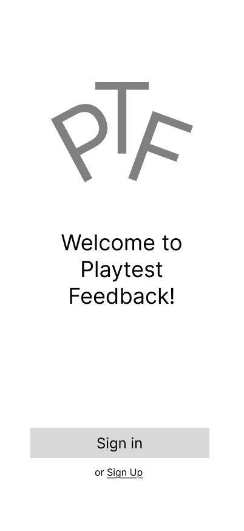

#### Sign in

Collects email and password, with Back and Continue controls. These are prototype fields; do not enter real credentials during a walkthrough.

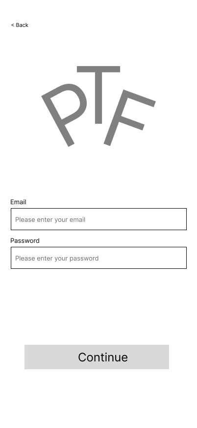

#### Sign up

Collects email, password and password confirmation. The user chooses Playtester or Developer before continuing.

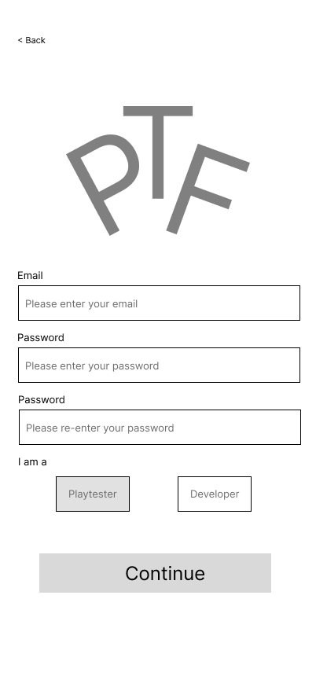

### Developer workflow

#### Developer hub

Provides My Projects, Account, Feedback History and Switch to Playtester Mode. The header menu and bottom navigation are shared across the signed-in screens.

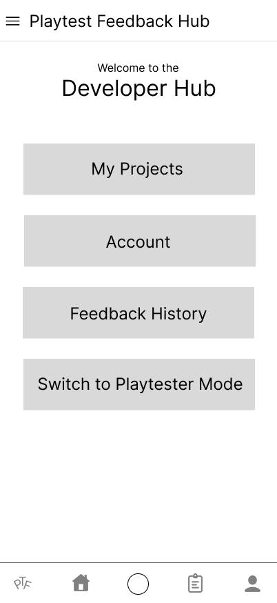

#### Choose project

Lists projects with a game name, developer and submission date. Selecting a project leads to its feedback; Add Project opens the project form. The source canvas places project image and QR placeholders in separate sibling groups, so those groups are retained in the source file but are absent from this individual frame export.

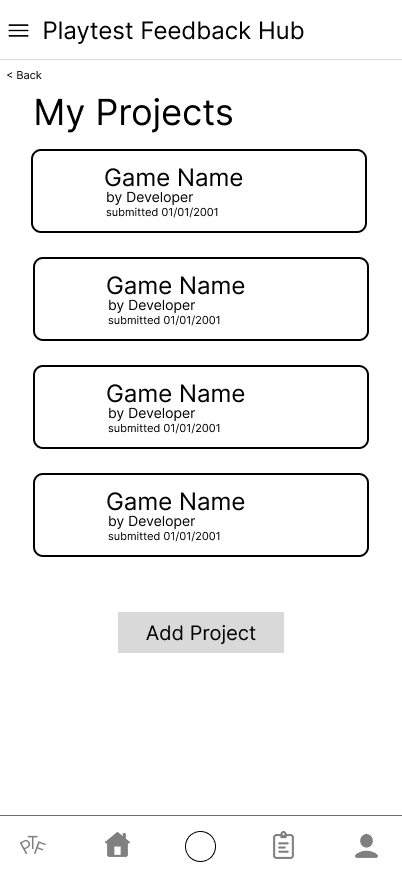

#### Add project

Collects a required game name and developer, an optional description and a project image placeholder. Add submits the project; Back returns to the previous screen.

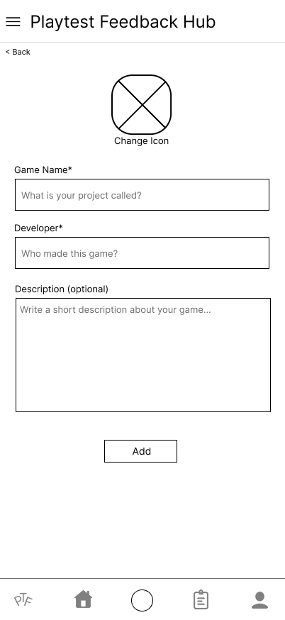

#### Project QR code

Displays the project QR placeholder for playtesters to scan and associate feedback with the selected project. Back returns to the previous screen.

#### Project feedback list

Shows feedback cards for a game with author, submission date and status labels such as Complete, Incomplete and WIP. Select a card to inspect feedback; the filter control opens the next state.

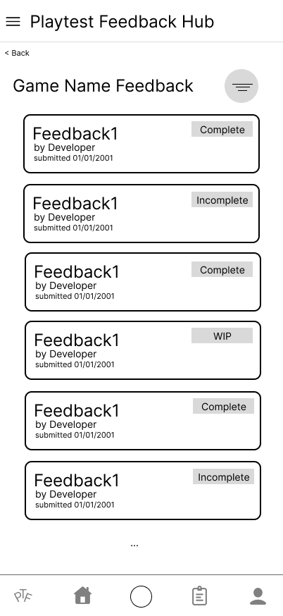

#### Feedback status filter open

Shows the expanded filter state over the feedback list. Although named Feedback Categories in Figma, the visible options are statuses: Complete, Incomplete, Work In Progress, Resolved and Assigned. This state must be reachable from the list filter control.

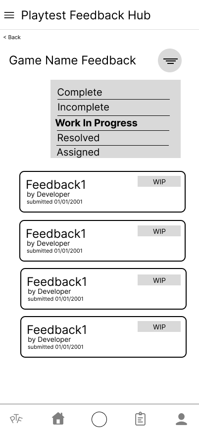

#### View feedback

Shows the game, current status, feedback category, feedback text and image placeholders. Mark Resolved represents updating the item status. The category field is visible, but a separate expanded category state is not present in the exported screen set.

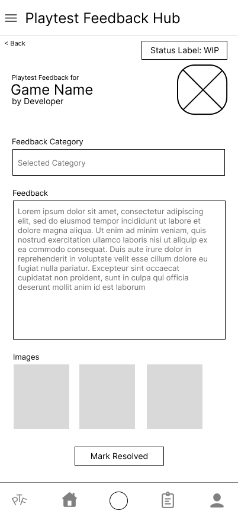

### Playtester workflow

#### Playtester hub

Offers Scan a QR Code, Account, Feedback History and Switch to Developer Mode. This is the current starting frame of the linked prototype.

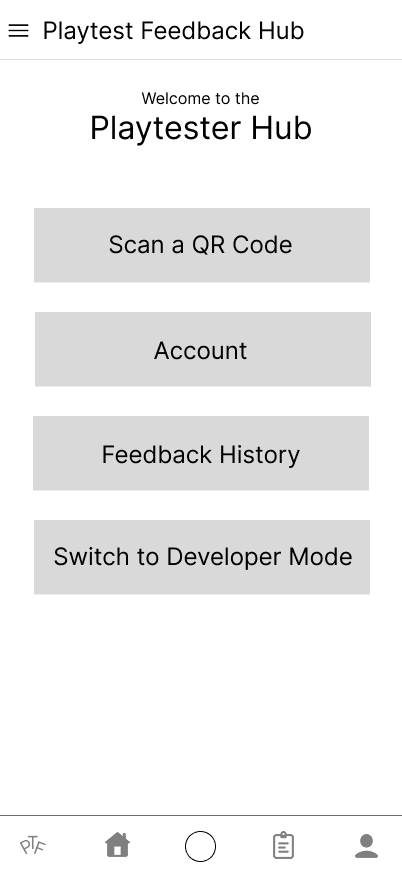

#### Scan QR code

Shows a camera/scanning placeholder and a Scan button to identify a project before writing feedback. The prototype should simulate scanning; no real camera permission is needed for reviewing these wireframes.

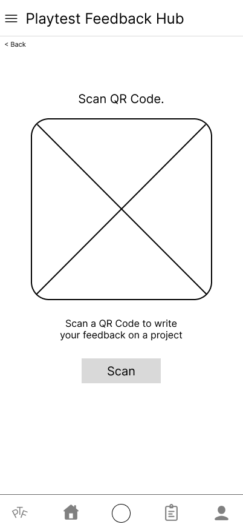

#### Write feedback

Shows the selected game and collects a required category and feedback text, optional images or URLs, and an anonymous-submission checkbox. Submit should lead to the confirmation screen. Expanded category choices and attachment states are not separate exported frames.

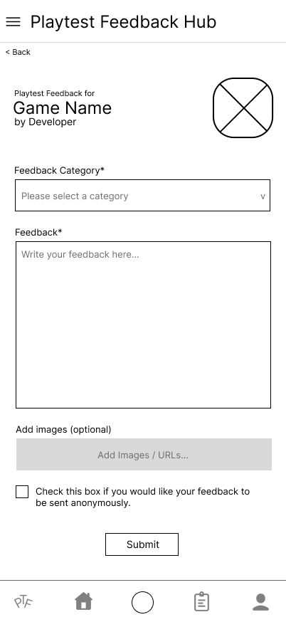

#### Feedback submitted

Confirms receipt and offers Scan another QR Code or Go to Playtest Hub. This frame is also named Scan QR Code in the Figma source; the repository filename distinguishes the success state.

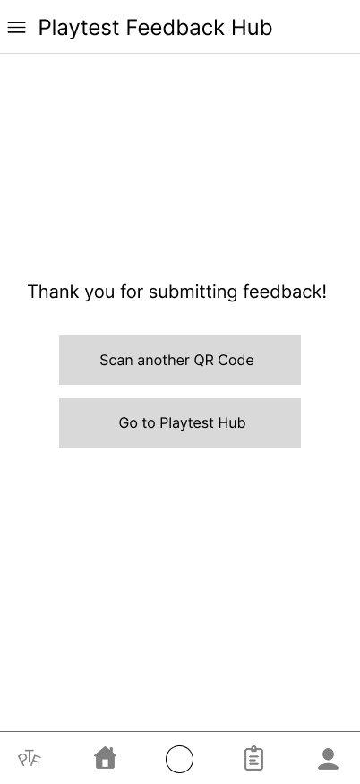

#### Feedback log

Lists games associated with prior feedback, including the developer and submission date, so a tester can revisit their feedback history.

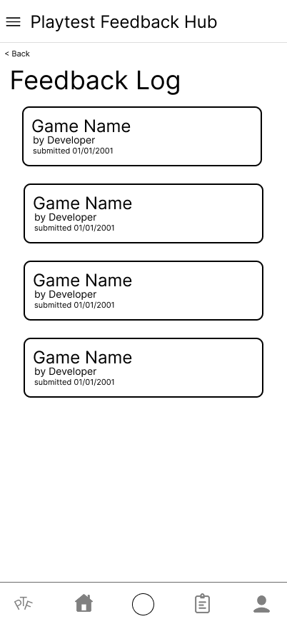

### Shared account and menu

#### Account

Displays a profile placeholder, username, email and Reset password. The reset flow is not represented by a separate exported frame.

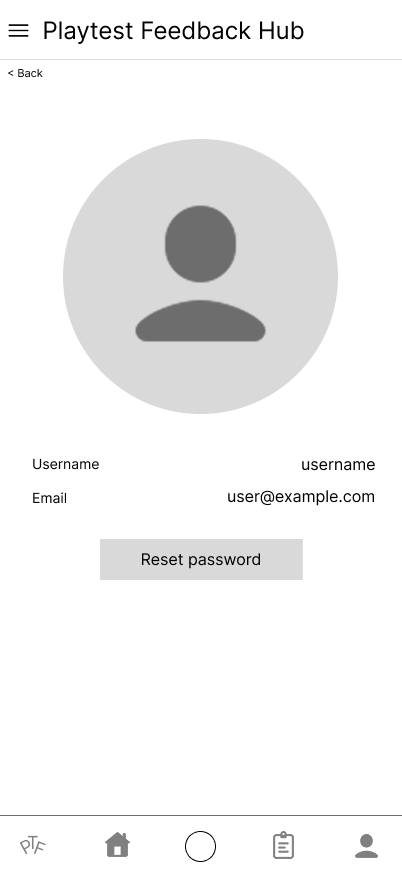

#### Navigation menu

Provides Sign Out and Switch Modes. This is a 286px-wide menu panel, not a complete 402px-wide phone view. The source needs an explicit full-screen overlay state to meet the same-width and dynamic-state requirements.

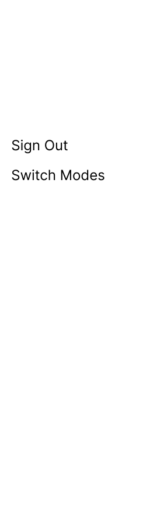

## Instruction check and remaining review

Checked against [Part A: App Map & Wireframes](instructions-0a-app-map-wireframes.md) and [Part B: Prototyping](instructions-0b-prototyping.md).

| Requirement | Result |
| --- | --- |
| Include App Map, individual PNGs and original sources | Exported App Map, 17 individual screen/panel PNGs, `.jam` and `.fig` sources are included. |
| Clear headings, logical order, descriptions and readable images | Each exported screen is embedded and described above. |
| Mobile layout and consistent width | 16 phone frames are 402 × 874px. Menu is a 286px panel and still needs a full-width overlay composition. |
| Content-only exports | Phone PNGs match frame bounds. App Map outer blank margin was trimmed. |
| Every dynamic state diagrammed | Status-filter and submission-success states exist. Expanded feedback-category selection, attachment controls, reset-password and failure/validation states still need review/additional frames. |
| Placeholder-only visual content | Existing designs contain logo/avatar/navigation icons and generic labels such as Game Name and username. Part A requests gray-box graphics and concrete dummy content; source cleanup is still needed. |
| All buttons and overlays functional | Not passed. In the linked mobile prototype, Scan a QR Code did not navigate from the Playtester Hub; Switch to Developer Mode navigated to the welcome screen; Sign in on that screen returned to the Playtester Hub. Remaining controls are unverified. |
| Anyone with the link can view the prototype | Not verified. The Share panel showed team/project access. The current account can view/comment but cannot edit the source or change its sharing settings. The owner must confirm public link viewing. |

The source owner/team should correct the remaining design and interaction items and confirm anonymous prototype access before treating Sprint 0 as fully complete. The exported sources preserve existing teammate work, including loose project image/QR groups that are outside the corresponding phone frame. No Figma design content or access settings were changed for this documentation update.
